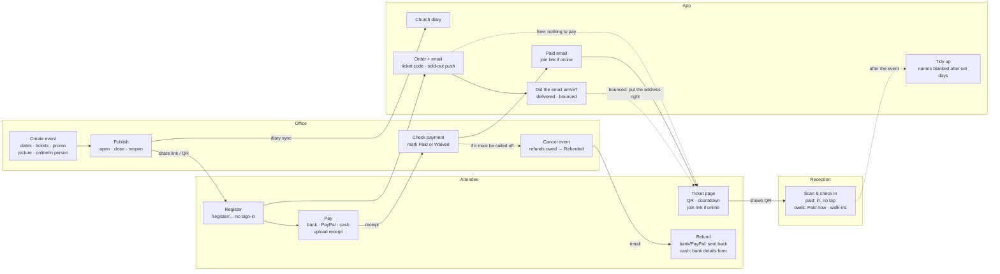

# How Registrations work

An event goes from a draft in the office to a ticket on someone's phone,
then to a scan at the door. If the event has to be called off, it ends
with refunds. Four parties take part: the **organisers** (the office),
the **attendee** (no account needed), **the app** (database rules and
emails), and **Reception** (at the door).

A visual version of this page, with a swimlane diagram, is in
[`registrations-overview.html`](./registrations-overview.html). Open it in
a browser. Keep the two in step: a change to one is a change to both.

## The whole flow

Solid arrows are the usual path. Dashed arrows are the branches: free
tickets skip paying, an email that bounces is put right from the ticket
page or by the office, an event can be cancelled at any time, and
personal details are tidied away after the event.

## Who does what

### Organisers — Registrations → an event

- Build the event: one or several dates; ticket types (free, paid,
  donation) with limits; promo codes that apply to every paid ticket or
  only chosen ones.
- Upload a picture and set its focus point, so the important part of it
  stays in view.
- Choose in person, online or both. For in person, type the address and
  place the map pin; directions and the map go to the pin. For online, add
  the join link and details.
- Publish to get the share link and a QR code. Close and reopen sales; a
  countdown on the register page shows when sales close. Once published,
  the link cannot change: it is in emails and on posters.
- Watch orders arrive, open receipts over the page, mark payments, add
  notes, and export to Excel. The event's page says up front what wants
  doing (receipts to check, payments awaited, refunds owed, emails not
  delivered), and an order that needs a decision carries it as a button
  on its row.
- See what became of each registration's email: **Email delivered**,
  **Email sent** (on its way), **Email delayed**, **Email bounced** (with
  the mail server's reason) or **Email not sent**. The **Undelivered**
  filter shows the ones that did not arrive, and the Excel export has an
  *Email status* column.
- Put a wrong address right: **Correct email address** on the row (or
  *Change email address* in its ⋯ menu) takes the right one and sends
  their email to it ten seconds later — time to press **Undo**. Left as
  it is, the same dialog just sends the email again.
- Cancel the event and settle refunds. An event can be deleted only once
  every paid order is refunded. Cancelling or deleting it takes its diary
  entries with it.

### Attendee — `/register/…` and `/ticket/…`, no account

- Opens the shared link, picks tickets and a date, adds names, and applies
  a promo code.
- Before anything is saved, is shown the email address they typed, on its
  own, and asked **Is this your email address?** A well-known provider
  spelt nearly right (gmial.com) is offered spelt right.
- Pays by bank transfer, the PayPal link, or at Reception, and uploads a
  receipt.
- Gets an email with an **Open ticket** button. The ticket page shows the
  QR code, the payment state, and a countdown to the start.
- If that email bounces, the ticket page says so — **We could not email
  you**, and to which address — within a minute or so of registering,
  without being reloaded, and takes the right address. Three corrections
  at most; after that it says to contact the church.
- For an online event, the join link appears once the ticket is confirmed
  and paid.
- Can cancel their own ticket until they are checked in.
- If the event is cancelled, bank and PayPal payers are refunded the way
  they paid, usually within 5–7 working days. If it has not come back by
  then, or they would rather have it in another account, they can send
  bank details from the ticket page. Cash payers must fill in that form,
  since cash has nowhere to go back to.

### Reception — `/door`

- Points the camera at a ticket's QR code, or types the code.
- A paid or free ticket for today checks in straight away, with no tap.
  A check-in is a day's: on the second day of a two-day event the same
  ticket is checked in again, and "here" counts today.
- A ticket that still owes is held up with **Check in** and **Paid now,
  check in**.
- Warns about cancelled tickets, tickets for another day, and people
  already checked in.
- Registers walk-ins on the spot, paid or free.

### The app — database rules and emails

- Creates the order and its ticket code, and sends the confirmation email.
- Keeps what became of every email it sends: the email service (Resend)
  reports back — delivered, delayed, bounced, held back, not sent — and
  the registration shows it.
- Puts the event on the church diary.
- Notifies the organisers when a ticket type sells out.
- Sends the "paid" email when a payment is marked, and the "cancelled"
  email to everyone if the event is called off.
- Blanks names, emails and phone numbers a set number of days after the
  event (`registration_anonymise()`). Counts and totals stay.

## Payments and refunds

Each order carries one payment state, which the organisers or Reception
move on.

| Order | States |
|---|---|
| A paid ticket | Awaiting payment → Receipt sent — being checked → **Paid**, or **Paid (waived)** |
| A free ticket, or 100% off with a promo code | **Nothing to pay** (Reception shows "Free with code …") |
| The event is cancelled | **Refund owed** → **Refunded** |

Bank details from the refund form can be seen only by people with the
Refunds right. They are wiped as soon as the order is marked Refunded.
The office sees on each refund whether details have come in, and the
refund sheet says where the money should go for every way of paying.

## Who is allowed to do what

Each part of the work is its own right (0251). Give a right to a role, or
to one person, in Settings → Access & Privileges. The database checks
every right (`registration_can()`), so hiding a button is never the only
protection.

| Right | Capability | What it lets someone do |
|---|---|---|
| Run registrations (all of it) | `reg.manage` | Everything below, except deleting an event |
| View & export | `reg.view` | See events, orders and promo codes; export to Excel; add notes |
| Make & edit events | `reg.edit` | Create and edit events, dates, tickets, promo codes and the picture |
| Approve payments | `reg.approve` | Mark Paid, waive, or set back to awaiting |
| Refunds | `reg.refund` | See refund details and mark orders Refunded |
| Cancel & delete | `reg.cancel` | Cancel or restore orders, cancel the event, delete it once refunds are done |
| Check people in | `reg.door` | Use Reception and the scanner |
| Take payments at the door | `reg.door_pay` | "Paid now, check in" at Reception |
| Register walk-ins | `reg.walk_in` | The Walk-in tab at Reception |
| Correct email addresses | `reg.email` | Put an attendee's address right, which sends their email again. Opens the Registrations page to read. **Admins have this one out of the box**; every other right above is nobody's until it is given |

## Safety built in

- **No back door.** The register and ticket pages need no account, but they
  open nothing else. They can't sign anyone in or reach the app. A ticket
  page shows only that one order, found by its long random code.
- **Join link.** An online event's link is never on the public page. It
  appears only on a ticket that is confirmed and paid, and goes away if
  the event is cancelled.
- **No lost money.** A paid event can't be deleted while anyone is still
  owed a refund. Cancelling keeps every order and who paid.
- **Privacy.** Personal details are blanked after the event. Receipts and
  refund details are visible only to people with the right to see them.
- **A wrong address is caught three times.** The register page shows the
  address back before registering. If the email still bounces, the ticket
  page tells the attendee and takes the right one — only after a bounce,
  so a link that has been passed on cannot be used to send a ticket
  somewhere else. And the office sees every bounce, with the reason, and
  can correct it.
- **Only Resend can say an email bounced.** The report-back address
  checks a signature on every call and writes nothing without it.
- **Undo.** Anything pressed on a registration — a payment marked
  received, a check-in, a cancellation, a refund, a note, a walk-in, an
  email address changed —
  says what it did with **Undo** beside it for ten seconds, and the
  registration's own row keeps Undo for ten minutes (its ⋯ menu on the
  event's page, a line under it at Reception). Undo puts the registration
  back exactly as it was. Only the person who pressed can undo it, and not
  once somebody else has changed that registration since. An email to the
  attendee ("your ticket is confirmed", their ticket) waits for the ten
  seconds, so a slip taken back in time never reaches them. Close
  registration and Reopen offer Undo the same way.

## Where it lives

- Migrations `0244`–`0251` (`supabase/migrations/`).
- `supabase/functions/registration-email/` sends every email.
- Email delivery: migration `0283`,
  `supabase/functions/registration-email-status/` (Resend's webhook) and
  `frontend/src/lib/emailDelivery.ts`.
- `frontend/src/lib/registrations.ts` and `lib/registrationRights.ts`.
- Undo: migration `0281` (`registration_order_undos`,
  `registration_order_undo()`) and `frontend/src/lib/registrationUndo.ts`.
- Pages: `RegistrationsPage`, `RegistrationEditorPage`,
  `RegistrationEventPage`, `RegisterPage`, `TicketPage` and `DoorPage`.
